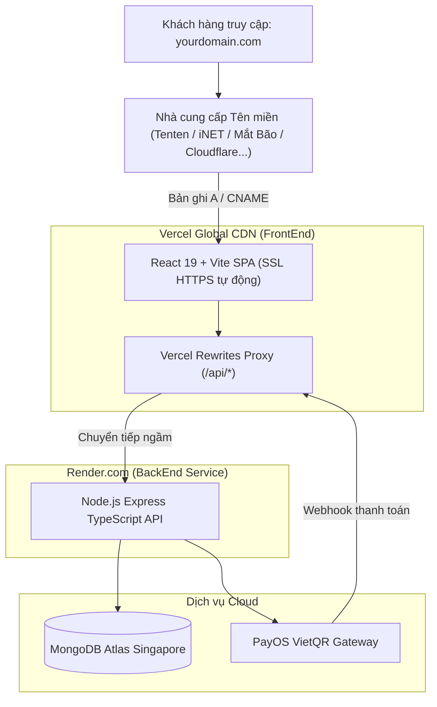

# 🌐 HƯỚNG DẪN TRIỂN KHAI PUBLIC & TRỎ TÊN MIỀN RIÊNG

Tài liệu này hướng dẫn chi tiết từng bước để đưa website **Tàn Sắc Vẹn Hương** lên môi trường Internet công khai (Public) và kết nối với **Tên miền riêng** bạn đã mua, hoàn toàn miễn phí chi phí duy trì máy chủ (Free Tier 100%).

---

## 🏗️ 1. MÔ HÌNH KIẾN TRÚC TRIỂN KHAI (ARCHITECTURE)



---

## 📋 2. CÁC BƯỚC THỰC HIỆN CHI TIẾT

### BƯỚC 1: ĐƯA DỰ ÁN LÊN GITHUB

1. Đăng nhập vào [GitHub](https://github.com/) và tạo một Repository mới (ví dụ đặt tên: `TanSacVenHuong`, để ở chế độ **Private** hoặc **Public**).
2. Tại máy tính của bạn, mở terminal tại thư mục dự án và chạy các lệnh:
   ```bash
   git add .
   git commit -m "feat: prepare production deployment with custom domain"
   git branch -M main
   git remote add origin https://github.com/TÊN_GITHUB_CỦA_BẠN/TanSacVenHuong.git
   git push -u origin main
   ```

---

### BƯỚC 2: DEPLOY BACKEND LÊN RENDER.COM (HOÀN TOÀN FREE)

1. Truy cập [Render.com](https://render.com/) -> Đăng nhập bằng tài khoản GitHub.
2. Nhấn nút **New +** -> Chọn **Web Service**.
3. Chọn Repository `TanSacVenHuong` vừa tạo.
4. Điền các thông số cấu hình:
   - **Name:** `tansacvenhuong-api` (hoặc tên bạn thích).
   - **Root Directory:** `BackEnd` *(bắt buộc điền)*.
   - **Environment:** `Node`.
   - **Build Command:** `npm install && npm run build`
   - **Start Command:** `npm start`
   - **Instance Type:** Chọn **Free**.
5. Nhấn mục **Environment Variables** (Biến môi trường) và thêm các khóa:
   - `NODE_ENV` = `production`
   - `PORT` = `5000`
   - `CLIENT_URL` = `https://TÊN_MIỀN_CỦA_BẠN,https://www.TÊN_MIỀN_CỦA_BẠN`
   - `MONGODB_URI` = *(Chuỗi kết nối MongoDB Atlas của bạn)*
   - `PAYOS_CLIENT_ID` = *(Lấy từ my.payos.vn)*
   - `PAYOS_API_KEY` = *(Lấy từ my.payos.vn)*
   - `PAYOS_CHECKSUM_KEY` = *(Lấy từ my.payos.vn)*
6. Nhấn **Create Web Service**. Chờ 2-3 phút, Render sẽ cấp cho bạn một URL công khai có dạng:
   👉 `https://tansacvenhuong-api.onrender.com`

---

### BƯỚC 3: DEPLOY FRONTEND LÊN VERCEL

1. Truy cập [Vercel.com](https://vercel.com/) -> Đăng nhập bằng tài khoản GitHub.
2. Nhấn nút **Add New...** -> Chọn **Project**.
3. Chọn Repository `TanSacVenHuong`.
4. Điền cấu hình:
   - **Project Name:** `tansacvenhuong`
   - **Framework Preset:** `Vite`
   - **Root Directory:** Nhấn Edit -> Chọn thư mục `FrontEnd` *(bắt buộc)*.
   - **Build Command:** `npm run build`
   - **Output Directory:** `dist`
5. Cập nhật file `FrontEnd/vercel.json` để trỏ API sang Render:
   ```json
   {
     "rewrites": [
       {
         "source": "/api/(.*)",
         "destination": "https://tansacvenhuong-api.onrender.com/api/$1"
       },
       {
         "source": "/(.*)",
         "destination": "/index.html"
       }
     ]
   }
   ```
   *(Thay `tansacvenhuong-api.onrender.com` bằng URL Render của bạn).*
6. Nhấn **Deploy**. Chỉ mất khoảng 30 giây, website của bạn đã online!

---

### BƯỚC 4: CẤU HÌNH TRỎ TÊN MIỀN RIÊNG (DNS SETUP)

Sau khi deploy FrontEnd trên Vercel:
1. Vào dự án của bạn trên Vercel -> Chọn tab **Settings** -> Mục **Domains**.
2. Nhập tên miền bạn đã mua (ví dụ: `yourdomain.com`) -> Nhấn **Add**.
3. Vercel sẽ tự động đề xuất thêm cả `www.yourdomain.com` -> Chọn **Recommended** (redirect `www` về root hoặc ngược lại).
4. Vercel sẽ hiển thị bảng giá trị DNS cần cấu hình. Bạn mở trang quản lý tên miền (nơi bạn mua tên miền như Tenten, iNET, Mắt Bão, Cloudflare, v.v.) và thêm 2 bản ghi sau:

| Loại bản ghi (Type) | Tên / Host (Name) | Giá trị (Value / Points to) | TTL |
| :--- | :--- | :--- | :--- |
| **A** | `@` *(hoặc để trống tùy nhà cung cấp)* | `76.76.21.21` | 3600 (hoặc Mặc định) |
| **CNAME** | `www` | `cname.vercel-dns.com` | 3600 (hoặc Mặc định) |

> [!NOTE]
> Sau khi lưu DNS, thường mất từ **5 đến 30 phút** (tối đa vài giờ) để tên miền lan tỏa trên toàn thế giới. Vercel sẽ tự động cấp chứng chỉ bảo mật **SSL (HTTPS có ổ khóa xanh)** hoàn toàn miễn phí.

---

### BƯỚC 5: CẬP NHẬT WEBHOOK TRÊN CỔNG PAYOS

1. Đăng nhập vào trang quản trị PayOS: [https://my.payos.vn/](https://my.payos.vn/).
2. Chọn kênh thanh toán của bạn -> Mục **Cài đặt Webhook**.
3. Điền đường link Webhook chính thức:
   👉 `https://TÊN_MIỀN_CỦA_BẠN/api/payment/webhook`
4. Nhấn **Lưu Webhook** và nhấn **Kiểm tra kết nối**. Khi PayOS báo "Kết nối thành công" là hoàn tất 100%!

---

## 🎯 3. DANH SÁCH KIỂM TRA TRƯỚC KHI BÀN GIAO (CHECKLIST)

- [x] FrontEnd build thành công (`npm run build`).
- [x] BackEnd TypeScript compile thành công (`tsc`).
- [x] File cấu hình điều hướng `FrontEnd/vercel.json` đã sẵn sàng.
- [x] Hệ thống CORS trên BackEnd đã mở rộng hỗ trợ tên miền tùy biến.
- [ ] Bạn cung cấp tên miền cụ thể để tôi hỗ trợ kiểm tra chi tiết cấu hình DNS.
