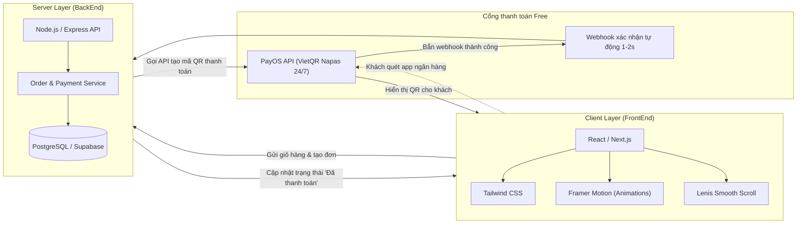
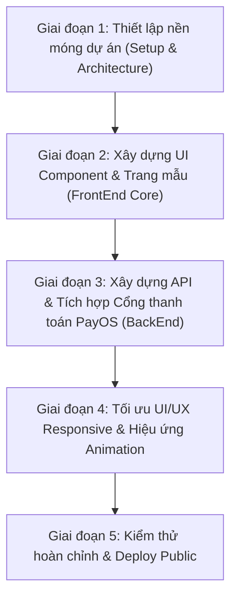

# 🌟 BẢN KẾ HOẠCH TỔNG THỂ DỰ ÁN: TÀN SẮC VẸN HƯƠNG

> **Định hướng cốt lõi:** Website trải nghiệm duy mỹ cao cấp (Modern Oriental / Luxury Minimalist), giao diện mượt mà với animation tinh tế, responsive 100% mọi màn hình, cổng thanh toán QR Code tự động **hoàn toàn miễn phí** (0% phí giao dịch) và sẵn sàng deploy public miễn phí.

---

## 1. TỔNG QUAN VÀ ĐỊNH VỊ SẢN PHẨM

| Hạng mục | Định hướng chi tiết |
| :--- | :--- |
| **Tên dự án** | **Tàn Sắc Vẹn Hương** (Sản phẩm hương thơm / Trầm hương / Nước hoa nghệ thuật / Phong cách sống) |
| **Phong cách thiết kế (Design Language)** | **Modern Oriental Minimalist / Dark Luxury** kết hợp chuyển động mượt mà (chữ uốn lượn như khói hương, hiệu ứng trôi lơ lửng, chuyển cảnh êm dịu). |
| **Mục tiêu người dùng** | Trải nghiệm mua sắm không ngắt quãng (Seamless Buying Flow) – từ xem sản phẩm, cảm nhận câu chuyện hương thơm đến thanh toán QR trong chưa đầy 1 phút. |
| **Nền tảng thanh toán** | **PayOS (VietQR Pro)**: 0đ phí duy trì, 0% phí giao dịch, xác thực tức thì qua Webhook. |
| **Môi trường triển khai** | Vercel (FrontEnd) + Render / Supabase (BackEnd & Database) – Miễn phí trọn đời (Free Tier). |

---

## 2. KIẾN TRÚC CÔNG NGHỆ ĐỀ XUẤT (TECH STACK)

### Chi tiết các công nghệ:
1. **FrontEnd:**
   - **Framework:** `React 19` + `Vite` (hoặc `Next.js 15 App Router` nếu muốn SEO mạnh). Đề xuất: **React + Vite** hoặc **Next.js** độc lập trong thư mục `FrontEnd`.
   - **Styling:** `Tailwind CSS v4` – Tối ưu responsive cực đại (`sm`, `md`, `lg`, `xl`, `2xl`).
   - **Hiệu ứng & Chuyển động:** `Framer Motion` (bắt buộc cho các animation mượt, fade, stagger, slide, parallax, gesture), kết hợp thư viện cuộn mượt `lenis`.
   - **Bộ icon & UI components:** `Lucide React` + `Radix UI / shadcn/ui` (cho drawer giỏ hàng, modal, popover, notification toast).

2. **BackEnd:**
   - **Runtime:** `Node.js` + `Express` (hoặc `Fastify`) viết bằng `TypeScript`.
   - **Cơ sở dữ liệu (Database):** `Supabase (PostgreSQL)` hoặc `MongoDB Atlas` (đều có gói Free hào phóng, bảo mật cao).
   - **ORM:** `Prisma` – Quản lý Schema sản phẩm, đơn hàng, hóa đơn cực kỳ trực quan và an toàn kiểu dữ liệu.

3. **Cổng thanh toán MIỄN PHÍ:**
   - **Lựa chọn tối ưu nhất: [PayOS](https://payos.vn)**.
     - **Chi phí:** 0% phí giao dịch, 0đ duy trì (Hoàn toàn FREE).
     - **Đối tượng:** Cá nhân hoặc doanh nghiệp đều đăng ký được dễ dàng (chỉ cần tài khoản ngân hàng cá nhân).
     - **Cơ chế:** Tự sinh mã VietQR động chứa đúng số tiền và mã hóa đơn duy nhất. Khi người mua quét mã từ bất kỳ App ngân hàng nào (Vietcombank, MB, Techcombank, MoMo...), tiền về thẳng tài khoản bạn, PayOS phát hiện và gửi Webhook về BackEnd trong **1 - 3 giây** để kích hoạt trạng thái "Thanh toán thành công" trên màn hình của khách.

4. **Triển khai (Deployment):**
   - **FrontEnd:** Deploy tự động lên **Vercel** (Miễn phí, hỗ trợ CDN toàn cầu tốc độ cao, cấp sẵn chứng chỉ SSL HTTPS).
   - **BackEnd:** Deploy lên **Render.com** hoặc **Railway** (Free/Starter tier) với biến môi trường an toàn.

---

## 3. CHIẾN LƯỢC UI/UX, RESPONSIVE & ANIMATIONS

> [!IMPORTANT]
> Đối với thương hiệu mang tính mỹ thuật như "Tàn Sắc Vẹn Hương", giao diện chính là linh hồn quyết định khả năng chuyển đổi đơn hàng.

### 3.1. Thiết kế Responsive đa tỉ lệ
- **Mobile First Approach:** Thiết kế trải nghiệm ngón cái (Thumb-zone): Thanh điều hướng dưới đáy (Bottom bar), giỏ hàng dạng Bottom-sheet vuốt lên, nút "Mua ngay / Thanh toán" luôn ghim cố định nổi bật.
- **Desktop Fluid Layout:** Sử dụng hệ thống lưới linh hoạt (CSS Grid & Flexbox) có thể co giãn tự nhiên từ màn hình laptop 13-inch tới màn hình rộng 2K/4K.
- **Breakpoints chuẩn:**
  - Phone: `360px - 640px` (tối ưu 1 cột, chạm vuốt mượt mà).
  - Tablet: `641px - 1024px` (lưới 2 cột, menu ẩn hoặc co gọn).
  - Desktop: `> 1024px` (lưới 3-4 cột, hiệu ứng hover, cursor tùy biến).

### 3.2. Hệ thống Animation & Micro-interactions
- **Page Transitions:** Chuyển đổi giữa các trang mượt mà không chớp nháy (AnimatePresence).
- **Hero Section:** Tiêu đề xuất hiện dần theo dạng text reveal, hình ảnh hương thơm/sản phẩm có hiệu ứng nổi nhẹ nhàng (floating parallax).
- **Product Showcase & Card:**
  - Hover zoom nhẹ vào chất liệu sản phẩm kèm hiệu ứng bóng đổ mờ ảo (Soft ambient blur).
  - Nút thêm vào giỏ hàng có animation nảy (spring bounce) kèm icon bay vào giỏ.
- **Cart Drawer:** Trượt vào mượt mà từ cạnh phải (Desktop) hoặc trượt từ dưới lên (Mobile) với nền mờ thủy tinh (Backdrop Blur / Glassmorphism).
- **Payment QR Modal:** Đếm ngược thời gian thanh toán thời gian thực, quét sóng xung quanh mã QR, hiệu ứng pháo hoa / checkmark xanh lục khi thanh toán thành công.

---

## 4. CÁC TRANG VÀ TÍNH NĂNG CHÍNH (SITEMAP & USER FLOW)

1. **Trang Chủ (Landing / Home):**
   - Hero Banner với nghệ thuật chữ và visual chủ đạo.
   - Triết lý hương / Câu chuyện thương hiệu ("Vẹn Sắc - Toàn Hương").
   - Bộ sưu tập tiêu biểu (Featured Collections) với chuyển động cuộn ngang (Horizontal scroll).
   - Đánh giá từ khách hàng & Báo chí / Nghệ nhân.
2. **Trang Danh mục & Chi tiết sản phẩm (Catalog & Product Detail):**
   - Bộ lọc hương (Nốt hương đầu, nốt giữa, nốt cuối / Tâm trạng / Không gian).
   - Thư viện ảnh sản phẩm độ phân giải cao kèm kính lúp phóng to (Zoom viewer).
   - Nút **"Mua ngay" (Express Checkout)** nhảy thẳng tới bước thanh toán QR.
3. **Giỏ hàng & Cổng thanh toán nhanh (Quick Checkout):**
   - Điền thông tin giao hàng siêu rút gọn (Họ tên, SĐT, Địa chỉ).
   - Phương thức thanh toán: **Chuyển khoản QR Napas 24/7 (PayOS)** và **COD (Thanh toán khi nhận hàng)**.
   - Màn hình hiển thị mã QR VietQR động kèm hướng dẫn thanh toán.
4. **Trang Thông báo Đơn hàng (Order Success / Tracking):**
   - Trạng thái trực tiếp của đơn hàng và mã vận đơn.

---

## 5. LỘ TRÌNH TRIỂN KHAI THEO TỪNG GIAI ĐOẠN (ROADMAP)

### Chi tiết từng giai đoạn:

#### 🔹 Giai đoạn 1: Khởi tạo Kiến trúc & Môi trường (Ngày 1)
- Thiết lập FrontEnd (`Vite + React + Tailwind CSS + Framer Motion` hoặc `Next.js`).
- Thiết lập BackEnd (`Node.js Express + TypeScript + CORS + dotenv`).
- Thiết lập cấu trúc thư mục chuẩn cho cả 2 bên.

#### 🔹 Giai đoạn 2: Thiết kế Giao diện Thẩm mỹ cao (Ngày 2 - 3)
- Tạo Theme màu sắc sang trọng (Dark Charcoal `#121212`, Vàng ánh kim Warm Gold `#D4AF37`, Giấy cổ Muted Cream `#F7F5F0`).
- Xây dựng Layout Responsive (Header navigation, Mobile menu, Footer).
- Xây dựng Hero Section chuyển động mượt, Product Card, Cart Drawer.

#### 🔹 Giai đoạn 3: Phát triển BackEnd & Cổng thanh toán PayOS (Ngày 3 - 4)
- Viết API lấy danh sách sản phẩm và chi tiết sản phẩm.
- Đăng ký và cấu hình API Key của PayOS.
- Viết API `POST /api/payment/create-qr`: Gọi PayOS tạo Payment Link / QR code.
- Viết API `POST /api/payment/webhook`: Nhận phản hồi thanh toán thành công và cập nhật trạng thái đơn hàng.

#### 🔹 Giai đoạn 4: Hoàn thiện Animation, Responsive & Trải nghiệm (Ngày 4 - 5)
- Thêm hiệu ứng chuyển trang, toast notification thông báo, đếm ngược QR.
- Kiểm tra hiển thị chuẩn xác trên iPhone, iPad, Android, Laptop và Màn hình Ultra-wide.
- Tối ưu hiệu năng nạp ảnh và kích thước bundle (Lighthouse Score > 90).

#### 🔹 Giai đoạn 5: Deploy Public & Bàn giao (Ngày 6)
- Đưa mã nguồn lên GitHub.
- Deploy FrontEnd lên **Vercel** (miễn phí, có link public dạng `tensacvenhuong.vercel.app` hoặc trỏ domain riêng).
- Deploy BackEnd lên **Render** (miễn phí).
- Cấu hình Webhook PayOS trỏ vào URL public của BackEnd.
- Kiểm thử luồng quét QR thanh toán thực tế với số tiền nhỏ (ví dụ 2.000 VNĐ).

