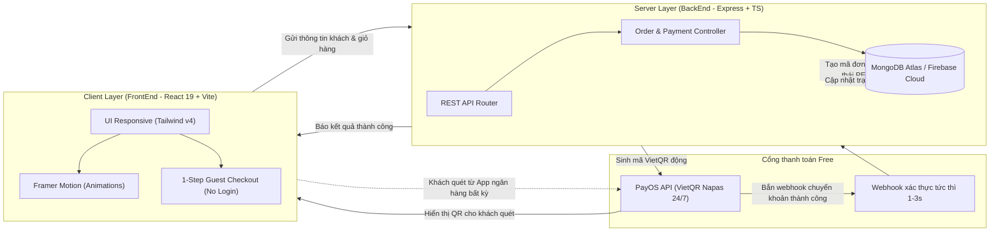
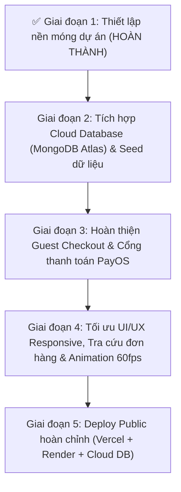

# 🌟 BẢN KẾ HOẠCH TỔNG THỂ DỰ ÁN: TÀN SẮC VẸN HƯƠNG

> **Định hướng cốt lõi:** Website trải nghiệm duy mỹ cao cấp (Modern Oriental / Luxury Minimalist), giao diện mượt mà với animation tinh tế, responsive 100% mọi màn hình, **mua hàng nhanh không cần đăng nhập (Frictionless Guest Checkout)**, cổng thanh toán QR Code tự động **hoàn toàn miễn phí** (0% phí giao dịch), lưu trữ dữ liệu trên **Cloud Database miễn phí** và sẵn sàng deploy public.

---

## 1. TỔNG QUAN VÀ ĐỊNH VỊ SẢN PHẨM

| Hạng mục | Định hướng chi tiết |
| :--- | :--- |
| **Tên dự án** | **Tàn Sắc Vẹn Hương** (Sản phẩm hương thơm / Trầm hương / Nước hoa nghệ thuật / Phong cách sống) |
| **Phong cách thiết kế (Design Language)** | **Modern Oriental Minimalist / Dark Luxury** kết hợp chuyển động mượt mà (chữ uốn lượn như khói hương, hiệu ứng trôi lơ lửng, chuyển cảnh êm dịu). |
| **Trải nghiệm mua hàng (UX)** | **Mua hàng siêu tốc không cần đăng nhập (1-Step Guest Checkout)**: Không yêu cầu tạo tài khoản hay mật khẩu rườm rà. Chỉ cần điền thông tin tối giản (Họ tên, SĐT, Địa chỉ) để hoàn tất đơn hàng trong 30 giây. |
| **Cơ sở dữ liệu (Cloud Database)** | **Cloud Database Miễn phí (MongoDB Atlas / Firebase Firestore)**: Lưu trữ danh mục sản phẩm, nốt hương nghệ thuật và lịch sử đơn hàng an toàn trên mây. |
| **Nền tảng thanh toán** | **PayOS (VietQR Napas 24/7)**: 0đ phí duy trì, 0% phí giao dịch, sinh mã QR động và xác thực tức thì qua Webhook 1–3s. |
| **Môi trường triển khai** | Vercel (FrontEnd) + Render / Cloud Database (BackEnd) – Miễn phí trọn đời (Free Tier). |

---

## 2. QUY CHUẨN MUA HÀNG KHÔNG CẦN ĐĂNG NHẬP (GUEST CHECKOUT)

> [!TIP]
> **Tại sao không cần đăng nhập?**
> Với các mặt hàng mang tính cảm xúc cao, quà tặng nghệ thuật như nước hoa và trầm hương, việc bắt khách hàng phải đăng ký tài khoản (nhập email, tạo mật khẩu, xác thực OTP) làm tăng tỷ lệ thoát đơn hàng (cart abandonment) lên tới 35-45%. Quy trình **Guest Checkout** giúp khách hàng mua sắm liền mạch không ngắt quãng.

### 2.1. Luồng mua hàng tối giản (Minimal Checkout Flow):
1. Khách chọn sản phẩm & nhấn **"Mua Ngay"** hoặc **"Thêm vào giỏ"**.
2. Mở trực tiếp Modal Thanh Toán (Bottom-sheet trên Mobile, Centered Modal trên Desktop).
3. **Chỉ yêu cầu 3 thông tin thiết yếu:**
   - **Họ và tên quý khách** (Để ghi thông tin người nhận).
   - **Số điện thoại** (Dùng để nhân viên liên hệ giao vận + Định danh tra cứu đơn hàng).
   - **Địa chỉ nhận hàng** (Số nhà, tên đường, khu vực).
   - *(Ghi chú thêm: Tùy chọn, ví dụ: gói quà, giao giờ hành chính...)*.
4. Chọn phương thức: **Chuyển khoản VietQR Napas 24/7 (Free 0%)** hoặc **COD (Thanh toán khi nhận)**.
5. Quét mã QR thanh toán -> Màn hình nhảy sang trạng thái "Thành công" và lưu đơn vào Cloud Database.

### 2.2. Cơ chế tra cứu đơn hàng cho khách:
- Khách không cần tài khoản, có thể xem lại đơn hàng thông qua:
  - **Mã đơn hàng (`#orderCode`)** hiển thị ngay sau khi thanh toán.
  - **Số điện thoại** của khách (BackEnd cung cấp API `/api/orders/lookup?phone=...` để tra cứu các đơn hàng đã đặt).
  - Trình duyệt tự động lưu lịch sử đơn hàng vào `localStorage` của khách để mở xem lại nhanh.

---

## 3. KẾ HOẠCH TÍCH HỢP CLOUD DATABASE (FIREBASE vs MONGODB ATLAS)

Để lưu trữ sản phẩm và đơn hàng bền vững trên Cloud (thay vì in-memory), chúng ta có 2 giải pháp Cloud Database hàng đầu có gói miễn phí vĩnh viễn (Free Tier):

### 3.1. Bảng so sánh chuyên sâu

| Tiêu chí | 🍃 **MongoDB Atlas (Khuyên dùng)** | 🔥 **Firebase Firestore** |
| :--- | :--- | :--- |
| **Gói miễn phí (Free Tier)** | **M0 Sandbox Free vĩnh viễn**: 512MB RAM/Storage, tối đa 500 kết nối, không giới hạn số lượt đọc/ghi hàng ngày. | **Spark Plan Free**: 1GB Storage, 50,000 lượt đọc/ngày, 20,000 lượt ghi/ngày. |
| **Vị trí Server (Latency)** | Chọn được cụm **Singapore (AWS `ap-southeast-1`)** – Độ trễ về Việt Nam siêu thấp (< 30ms). | Cụm **Singapore (`asia-southeast1`)** – Tốc độ rất nhanh tại Việt Nam. |
| **Phù hợp kiến trúc** | Cực kỳ tương thích với BackEnd **Node.js Express + TypeScript** hiện tại thông qua ODM `Mongoose`. Dễ viết query, populate, aggregate. | Phù hợp cho kiến trúc Serverless hoặc Realtime trực tiếp từ Client. Cần cài đặt `firebase-admin` trên Node.js. |
| **Tính năng Real-time** | Cần kết hợp Webhook / Polling / Socket.io. | Có sẵn SDK Realtime Listener (`onSnapshot`) cực mạnh. |
| **Cấu hình & Quản lý** | Cực kỳ trực quan: Tạo tài khoản, copy chuỗi `MONGODB_URI` vào file `.env` của BackEnd là chạy ngay. | Cần tạo Project trên Firebase Console, tạo Service Account JSON key để xác thực. |
| **Đánh giá tổng quan** | ⭐ **Lựa chọn tối ưu nhất** cho hệ thống Express REST API độc lập, bảo mật và chuẩn công nghiệp. | ⭐ Rất mạnh nếu muốn tính năng thông báo Real-time đẩy thẳng xuống FrontEnd. |

### 3.2. Quyết định đề xuất: **MongoDB Atlas + Mongoose**
- **Lý do:** Dự án đã có kiến trúc BackEnd `Node.js Express TypeScript` hoàn chỉnh. MongoDB Atlas cung cấp mô hình dữ liệu Document NoSQL cực kỳ phù hợp với cấu trúc phân tầng nốt hương (`notes: { top, middle, base }`) và danh sách giỏ hàng lồng nhau.
- **Dung lượng 512MB Free:** Đủ sức lưu trữ hơn 200.000 đơn hàng và hàng nghìn sản phẩm mà không tốn bất kỳ chi phí nào.

### 3.3. Thiết kế Cấu trúc Dữ liệu (Database Schema)

#### Collection `products` (Danh mục sản phẩm):
```typescript
{
  _id: ObjectId,
  id: String,           // Ví dụ: 'tsvh-01'
  name: String,         // 'Tàn Dạ Trầm Y'
  subtitle: String,     // 'Nước hoa nghệ thuật Extrait de Parfum'
  category: String,     // 'nuoc-hoa' | 'tram-huong' | 'tinh-dau' | 'nen-thom'
  price: Number,        // 1850000
  originalPrice: Number,// 2200000 (tùy chọn)
  volume: String,       // '50ml'
  description: String,
  story: String,
  notes: {
    top: [String],      // ['Hạt tiêu hồng', 'Cam Bergamot hun khói']
    middle: [String],   // ['Trầm hương cổ thụ', 'Nhựa thơm Myrrh']
    base: [String]      // ['Gỗ Đàn Hương Mysore', 'Hổ phách xám']
  },
  image: String,        // URL ảnh sắc nét
  badge: String,        // 'Signature Blend'
  inStock: Boolean,     // true
  rating: Number,       // 4.9
  reviewsCount: Number, // 128
  createdAt: Date
}
```

#### Collection `orders` (Đơn hàng Guest Checkout):
```typescript
{
  _id: ObjectId,
  orderCode: Number,    // Mã số nguyên duy nhất (Ví dụ: 82910472), dùng cho PayOS
  customer: {
    name: String,       // Họ tên khách
    phone: String,      // Số điện thoại (chỉ mục index để tra cứu nhanh)
    address: String,    // Địa chỉ giao nhận
    notes: String       // Ghi chú nếu có
  },
  items: [
    {
      productId: String,
      name: String,
      price: Number,
      quantity: Number,
      image: String
    }
  ],
  totalAmount: Number,  // Tổng tiền đơn hàng
  paymentMethod: String,// 'vietqr' | 'cod'
  status: String,       // 'PENDING' | 'PAID' | 'CANCELLED'
  qrCodeUrl: String,    // Link ảnh VietQR động
  payosPaymentLinkId: String,
  createdAt: Date,
  paidAt: Date          // Thời điểm thanh toán thành công
}
```

---

## 4. KIẾN TRÚC CÔNG NGHỆ TỔNG THỂ (TECH STACK)



---

## 5. LỘ TRÌNH TRIỂN KHAI THEO TỪNG GIAI ĐOẠN



### Chi tiết các bước thực hiện tiếp theo:

#### 🔹 Giai đoạn 2: Kết nối Cloud Database (MongoDB Atlas) — ĐÃ TRIỂN KHAI
1. Cài đặt `mongoose` trong `BackEnd`.
2. Tạo file kết nối `src/config/database.ts` với cơ chế tự động kết nối lại (Auto-reconnect) và Fallback an toàn.
3. Tạo Mongoose Models cho `Product` và `Order`.
4. Viết script Seed dữ liệu các tác phẩm hương thơm độc bản vào Cloud Database.
5. Cung cấp API Tra cứu đơn hàng theo Số điện thoại cho khách: `GET /api/payment/lookup-orders?phone=0987654321`.

**Kết quả trong repo:** Mongoose models cho `Product` và `Order`, kết nối MongoDB bắt buộc khi backend khởi động, seed sản phẩm mẫu khi collection rỗng (kèm lệnh upsert chủ động), CRUD đọc sản phẩm từ database, lưu đơn/trạng thái PayOS trong MongoDB, tính tổng tiền phía server từ giá trong database, và API `GET /api/payment/lookup-orders?phone=...` trả về lịch sử đơn giới hạn 50 bản ghi mà không tiết lộ địa chỉ/ghi chú giao nhận.

#### 🔹 Giai đoạn 3: Hoàn thiện Cổng thanh toán PayOS & Webhook
1. Đăng ký tài khoản PayOS miễn phí tại [my.payos.vn](https://my.payos.vn) để lấy Client ID, API Key, Checksum Key.
2. Cấu hình Webhook PayOS tự động cập nhật trạng thái đơn hàng trong Cloud Database sang `PAID`.
3. Kiểm thử luồng quét QR thực tế và luồng giả lập 1-click.

#### 🔹 Giai đoạn 4: Hoàn thiện UI/UX & Responsive đa màn hình
1. Thiết kế trang hoặc Drawer "Tra cứu đơn hàng" nhanh bằng Số điện thoại (dành cho khách không cần đăng nhập).
2. Tối ưu chuyển động mượt mà trên iPhone, Android và Desktop màn hình rộng.
3. Bổ sung hiệu ứng chúc mừng và âm thanh thông báo nhẹ nhàng khi thanh toán thành công.

#### 🔹 Giai đoạn 5: Triển khai Public (Deploy)
1. Đẩy mã nguồn lên GitHub.
2. Deploy FrontEnd lên **Vercel** (miễn phí, có SSL tự động).
3. Deploy BackEnd lên **Render.com** (miễn phí).
4. Kết nối biến môi trường `MONGODB_URI` và PayOS Keys trên Render.
5. Kiểm thử toàn bộ hệ thống trên đường link public thực tế.
